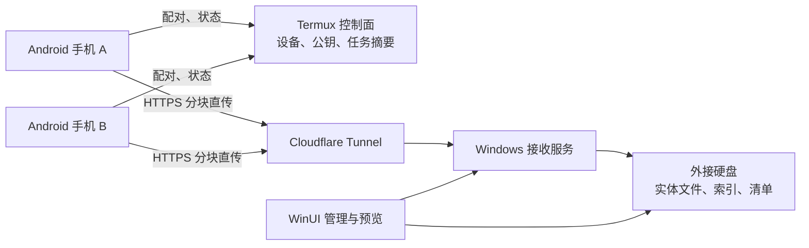
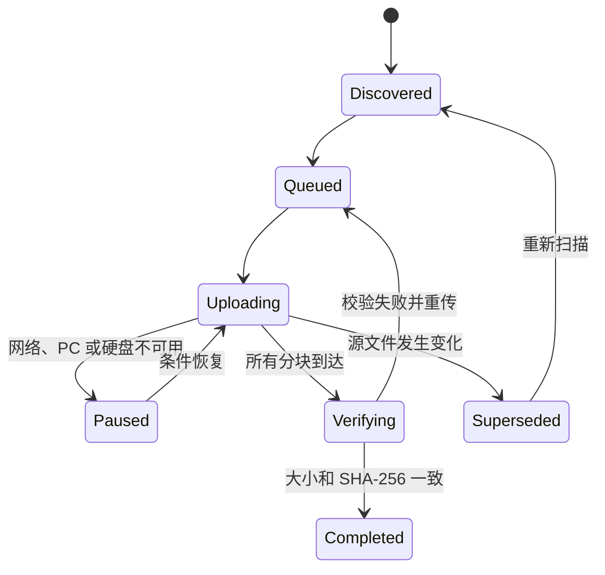

# 系统架构

## 总览

控制面和数据面严格分离。Termux 服务掉线不会使已配对设备丧失 PC 地址与设备凭据，文件也不会因控制面中转而形成流量与存储瓶颈。

## 组件职责

| 组件 | 技术 | 职责 |
| --- | --- | --- |
| Android | Kotlin、Compose、AlarmManager、WorkManager | 授权目录、扫描、增量清单、分块上传、通知与任务恢复 |
| Windows UI | C#、WinUI 3 | 配对、设备与任务状态、存储设置、搜索和预览 |
| Windows Receiver | ASP.NET Core 10 | 身份校验、分块会话、完整性校验、安全落盘 |
| Windows Core | .NET 10 类库 | 跨平台无关的路径、命名、哈希与归档规则 |
| Termux Server | Go、SQLite | 设备公钥、连接协调、最近 30 天任务摘要 |
| Protocol | OpenAPI 3.1 | 跨端版本化 HTTP 契约 |

## 上传状态机

PC 只在 `Completed` 后确认成功。Android 保留队列，直到收到成功确认并持久化本地状态。

## 数据模型

### 文件身份

- `deviceId`：配对时生成的稳定设备 ID；
- `contentSha256`：实体内容身份；
- `sourceUri`：Android MediaStore 或 SAF URI，仅保存在 Android；
- `relativePath`：源目录中的相对路径；
- `backupDate`：北京时间扫描日期；
- 同一路径内容变化时，目标名称加入内容哈希后缀并保留旧实体；
- Android 队列以源 URI、大小、修改时间和内容哈希判断是否需要再次上传。

### 并发

- PC 允许两台设备并行；
- 每台设备默认一个文件流；
- 每个文件内部按序上传 8MB 分块；
- 同一 `uploadId + chunkIndex` 重试必须幂等。

## 恢复设计

- 普通文件可直接从日期目录复制恢复；
- PC 客户端可直接定位和打开日期目录中的历史实体；
- 每个日期目录写入追加式 JSONL 清单；
- 主 SQLite 索引损坏时不影响普通文件恢复；自动重建工具属于后续维护功能；
- 第一版不自动写回 Android 原目录。
